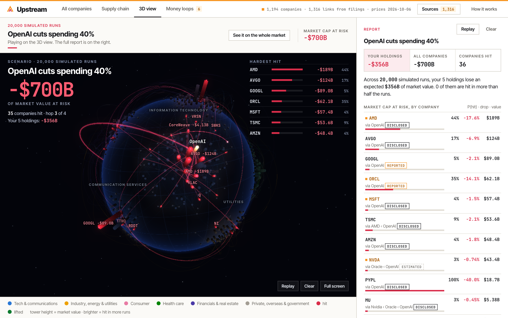
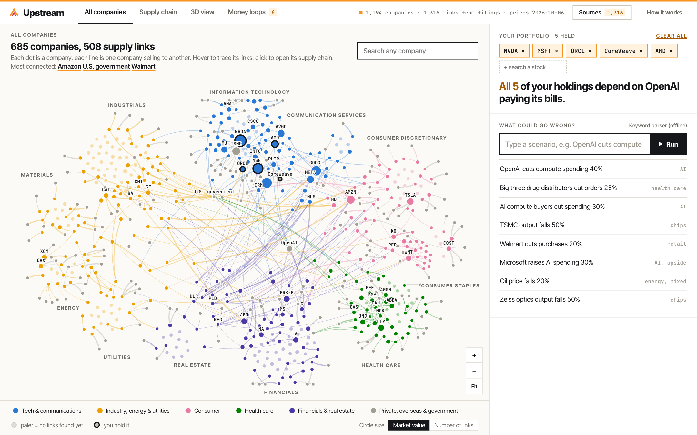
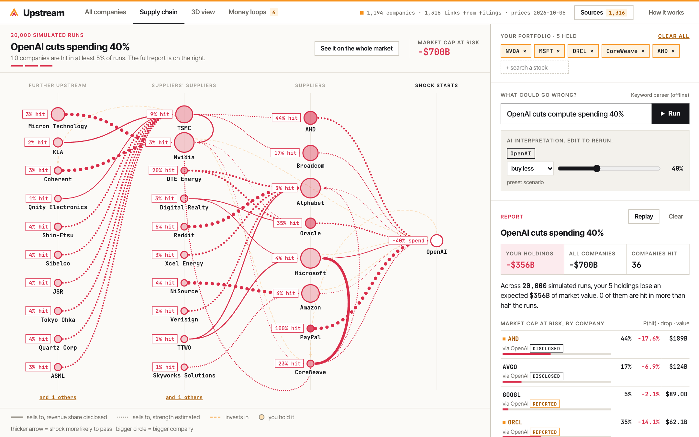
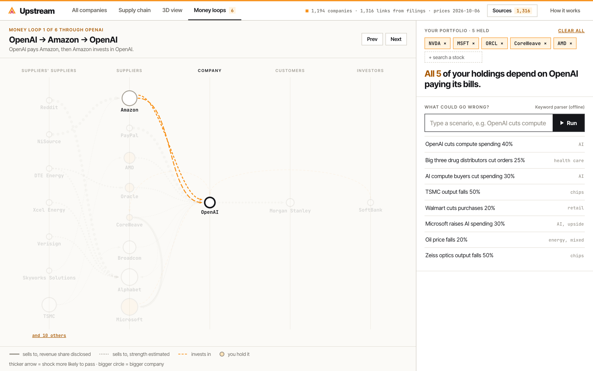

# Upstream

Type what could go wrong. See which of your stocks it hits.

Investors think they own several different AI stocks, but many depend on the same customer (OpenAI) and on each other through circular deals. Upstream maps 12 companies and 26 sourced deals, then runs a shock through the network so you can see which holdings get hit and by how much.

This is version 3 (whole S&P 500 market, Monte Carlo cascade, network and 3D views). The original 12-company demo, with its screenshots and demo video, is on the [`v1`](../../tree/v1) branch; version 2 is on [`v2`](../../tree/v2).



## Screenshots

**All companies.** Every S&P 500 company and its counterparties, placed by sector. Lines are who sells to whom.



**A scenario on the supply chain.** "OpenAI cuts compute spending 40%" run 20,000 times. Each supplier shows how often it gets hit, and the report on the right prices the damage to your portfolio.



**Money loops.** Circular deals where money flows out and comes back.



## How it works

- **Data:** `data/graph.json` holds all 500 S&P companies plus their counterparties, with links taken from filings, 13F forms, press releases and credible reports. `data/evidence.js` holds the quote and document behind every link. Rebuild everything with `npm run data` (or `python3 tools/build_data.py "<path to model bundle>"` then `node tools/layout.mjs`).
- **All companies:** a network map of every S&P 500 company and its counterparties. Position is the sector, colour is the sector family, lines are who sells to whom. Hover to trace a company's links, zoom for more names, click to open its supply chain. The layout is fixed and comes from `node tools/layout.mjs`.
- **3D view:** the market as a planet, for presenting. Each continent is a sector, each tower is a company and its height is market value. A scenario plays as a show: the planet turns to the starting company, a blast wave crosses the surface, the shock flies along the links hop by hop, and the counters add up the market value at risk. Press F for full screen and Space to replay. It uses `vendor/three.min.js` and `vendor/three-post.js`, saved locally so it works offline.
- **Supply chain:** suppliers on the left, the company in the middle, customers on the right, for any company you search.
- **Link strength:** `p = base x size x confidence`. Base is the disclosed revenue share, or 1 / number of buyers (weighted cascade, Kempe, Kleinberg and Tardos 2003). Size is sqrt(buyer market cap / seller market cap), capped at 1. Confidence is 1.0 disclosed, 0.7 reported, 0.4 estimated.
- **Scenario:** the AI picks only the starting companies and a severity. An independent cascade then runs 20,000 times in the browser (Monte Carlo).
- **Report:** P(hit), predicted drop (severity x 0.6 per extra hop) and market cap at risk for each company, with your holdings marked.
- **Hand-added links:** `data/extra_links.json` holds links found outside the bundle: the chain behind TSMC (Zeiss, ASML, photoresist, quartz, packaging film) and the big drug makers' sales through McKesson, Cencora and Cardinal Health. Each carries its source and a note on how far it was checked.
- **Known limits:** links without a disclosed share count equally, only signed deals are seen, shocks are treated as independent, and the damping and confidence weights are assumptions.

## Run it locally

Needs Node 18+. No npm install.

```bash
git clone https://github.com/meethjaswani/upstream-demo && cd upstream-demo
npm start                   # open http://localhost:3000
```

**Bring your own API key.** Free-text scenarios are read by an LLM. Click **Use your own API key** under the scenario box and paste an Anthropic (`sk-ant-...`) or OpenRouter (`sk-or-...`) key. OpenRouter has free models, so a free OpenRouter account is enough. The key stays in your browser's local storage and is only sent to your local server, which passes it to the provider with each request. **Remove** deletes it.

To set a key once for everyone using your server, put it in `.env` instead (see `.env.example`).

Without a key, the built-in keyword parser reads the scenario.

No key, or just want the static version? Open `index.html` directly. The keyword parser and recorded trace still work.

## Roadmap

An AI extraction pipeline on AWS Bedrock reading SEC EDGAR, HKEX filings and press releases, producing the same JSON schema, so the map updates itself and covers any sector.
